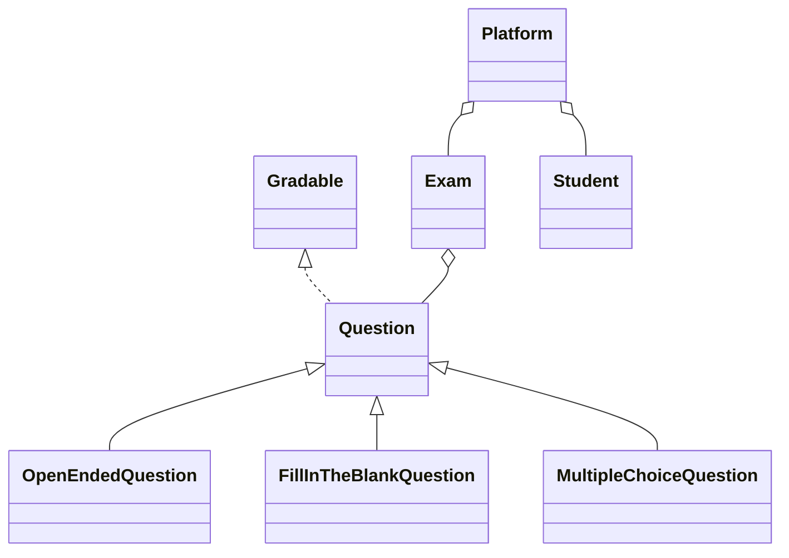

# Exam Platform

[](https://github.com/andreipopa05/exam-platform/actions/workflows/ci.yml)

A command-line exam platform written in Java, similar to a simplified Moodle: it manages exams, questions of three types, students and grading. The platform reads commands from a text file, one command per line, and writes its results into files.

It is a showcase of **object-oriented design** (abstraction, inheritance, polymorphism, encapsulation), **Java collections**, **generics**, **custom exceptions** and **file I/O**.

## Features

- Exams with a time interval, and questions added over time.
- Three question types with different grading rules.
- Students submit answers; submissions outside the exam interval are rejected with a custom exception and score 0.
- Reports: question history, printable exam, student scores and a sorted report of all students.

## Commands

Every command has the form `<timestamp> | <command> | <parameters separated by " | ">`. The timestamp format is `dd-MM-yyyy-HH-mm` (for example `01-01-2025-09-05`). Commands appear in chronological order.

```text
<timestamp> | create_exam | <exam> | <start> | <end>
<timestamp> | add_question | <type> | <exam> | <author> | <difficulty> | <max_score> | <text> | <right_answer>
<timestamp> | list_questions_history | <exam>
<timestamp> | print_exam | <exam>
<timestamp> | register_student | <name> | <group>
<timestamp> | submit_exam | <exam> | <student> | <answer 1> | ... | <answer N>
<timestamp> | show_student_score | <student> | <exam>
<timestamp> | generate_report | <exam>
<timestamp> | exit
```

| Command | What it does |
|---|---|
| `create_exam` | Creates an exam that can be taken between the start and end timestamps |
| `add_question` | Adds a question to an exam. Types: `open_ended`, `fill_in_the_blank`, `multiple_choice` (the right answer is `A`, `B`, `C` or `D`) |
| `list_questions_history` | Writes the questions sorted by the time they were added, then by author |
| `print_exam` | Writes the questions sorted by difficulty, then by text |
| `register_student` | Registers a student (unique by name) |
| `submit_exam` | Grades the answers of a student. The answers follow the order of `print_exam`, **even if the exam was not printed yet or questions were added later** |
| `show_student_score` | Appends the current score of a student to `console.out` |
| `generate_report` | Writes every student of the exam with the score, sorted by name |
| `exit` | Stops reading commands |

### Grading

| Question type | Correct | Partially correct | Wrong |
|---|---|---|---|
| `multiple_choice` | same letter: 100% | (none) | 0% |
| `fill_in_the_blank` | same text: 100% | length within ±2 letters of the right answer, and one text contains the other: 50% | 0% |
| `open_ended` | same text: 100% | length within ±30% of the right answer, and one text contains the other: 70% | 0% |

The score of a question is its maximum score times that percentage. A submission before the start or after the end of the exam throws `SubmissionOutsideTimeIntervalException`; the score is 0 and the message `<timestamp> | Submission outside of time interval for student <name>` is written to `console.out`.

## Design



| Class | Role |
|---|---|
| `Main` | Reads the file and calls the platform; it contains no logic |
| `Platform` | Executes the commands, keeps the exams and the students and writes the output files |
| `Exam` | Questions, time interval and scores of one exam |
| `Student` | Name, group and the score at every exam |
| `Gradable` | Interface: the percentage a degree of correctness is worth |
| `Question<T>` | Abstract question. `T` is the type of the answer: `String` for open-ended and fill-in-the-blank, `ResponseOption` for multiple choice |
| `Correctness`, `ResponseOption` | Enums: correct/partial/wrong and the letters A–D |
| `SubmissionOutsideTimeIntervalException` | Checked exception with the timestamp of the late submission |

- **Generics:** `Question<T>` declares `checkAnswer(T)`, so every type of question checks its own kind of answer. `parseAnswer` converts the text of an answer to `T`, and `score(String)` ties it all together.
- **Polymorphism:** `Exam` grades the answers by calling `score` on each question; it never asks what type a question is.
- **Encapsulation:** all attributes are private; collections are not handed out for modification (`Student.getExamScores()` is read-only).

### Collections

| Collection | Where | Why |
|---|---|---|
| `HashMap<String, Exam>`, `HashMap<String, Student>` | `Platform` | Every command finds an exam or a student by name: O(1) |
| `ArrayList<Question<?>>` | `Exam` | Questions are only appended, in chronological order, and read as a whole. A `TreeSet` would give O(log n) insertion but would drop two questions that compare equal (same difficulty and text) |
| Cached sorted `ArrayList` | `Exam` | The print order is computed once and reused until a question is added, so repeated `print_exam` and `submit_exam` do not sort again |
| `TreeMap<String, Double>` | `Exam` | Scores by student name. The report is already sorted, so `generate_report` does not sort: O(s) for s students, and O(log s) to record a score |
| `HashMap<String, Double>` | `Student` | Score by exam name: O(1) |

## Build and run

JDK 17 or newer. Gradle is downloaded by the wrapper.

```bash
./gradlew build
./gradlew run --args="examples/01-basics/input.in build/output/01-basics"
```

(`gradlew.bat` on Windows.) The program takes the input file and an output directory (created if it does not exist). `console.out` is recreated on every run.

Output files:

| File | Written by |
|---|---|
| `questions_history_<exam>_<timestamp>.out` | `list_questions_history` |
| `print_exam_<exam>_<timestamp>.out` | `print_exam` |
| `exam_report_<exam>_<timestamp>.out` | `generate_report` |
| `console.out` | `show_student_score` and late submissions |

## Example

`examples/01-basics/input.in` (shortened):

```text
01-01-2025-09-00 | create_exam | Algorithms | 01-01-2025-10-00 | 01-01-2025-12-00
01-01-2025-09-05 | add_question | multiple_choice | Algorithms | Prof Ionescu | 3 | 10 | What is the complexity of binary search? A) O(n) B) O(log n) C) O(n log n) D) O(1) | B
01-01-2025-09-06 | add_question | open_ended | Algorithms | Prof Ionescu | 2 | 5 | What principle does a stack follow? | last in first out
01-01-2025-09-06 | add_question | fill_in_the_blank | Algorithms | Prof Dumitru | 2 | 5 | A queue follows the ___ principle | FIFO
01-01-2025-09-15 | print_exam | Algorithms
01-01-2025-09-20 | register_student | Ana Popescu | 321CB
01-01-2025-10-30 | submit_exam | Algorithms | Ana Popescu | FIFO | last in first out | B
01-01-2025-10-45 | submit_exam | Algorithms | Bogdan Radu | FIF | last in | A
01-01-2025-10-46 | submit_exam | Algorithms | Dan Voinea | FIFOS | the last in first out | B
01-01-2025-12-30 | submit_exam | Algorithms | Carmen Ilie | FIFO | last in first out | B
01-01-2025-12-40 | generate_report | Algorithms
```

`print_exam_Algorithms_01-01-2025-09-15.out` (maximum score, text, difficulty, right answer):

```text
5.0 | A queue follows the ___ principle | 2 | FIFO
5.0 | What principle does a stack follow? | 2 | last in first out
10.0 | What is the complexity of binary search? A) O(n) B) O(log n) C) O(n log n) D) O(1) | 3 | B
```

`exam_report_Algorithms_01-01-2025-12-40.out`:

```text
Ana Popescu | 20.00
Bogdan Radu | 2.50
Carmen Ilie | 0.00
Dan Voinea | 16.00
```

- **Ana** answered everything correctly: 5 + 5 + 10.
- **Bogdan** wrote `FIF` for `FIFO` (partially correct, 50% of 5); the other two answers were wrong.
- **Dan** got 50% of 5 and 70% of 5 for two partially correct answers, and 10 for the third.
- **Carmen** submitted after the end of the exam, so she got 0, and `console.out` contains `01-01-2025-12-30 | Submission outside of time interval for student Carmen Ilie`.

## Tests

```bash
./gradlew test\
```

- `QuestionTest`: the grading rules (partial credit limits for each question type).
- `ExamTest`: the exception, the limits of the time interval, the order of the answers when questions are added after `print_exam`, and the sorted report.
- `ExamplesTest`: runs every folder in `examples/` and compares each produced file with the one in `expected/`.

The expected files of the examples were not copied from the program. They were computed by `tools/gen_examples.py`, a separate reference implementation written from the specification.

## Project structure

```text
exam-platform/
├── src/main/java/examplatform/   the platform
├── src/test/java/examplatform/   unit and example tests
├── examples/                     input.in and expected/ for each example
├── tools/gen_examples.py         reference implementation used to generate the examples
├── build.gradle
└── README.md
```

## Limitations and ideas

- The input is assumed to be valid: the commands are chronological, and the exams and students used by a command exist.
- A student who did not submit an exam has the score 0.00 in the reports.
- Idea for an extension: courses (classes) that group students, teachers and exams, with announcements for the participants.